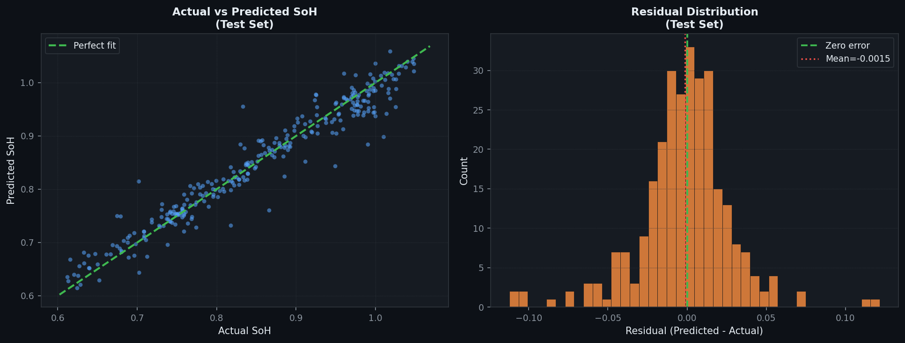
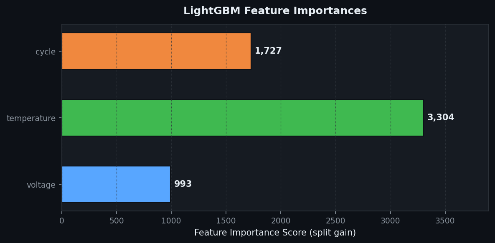
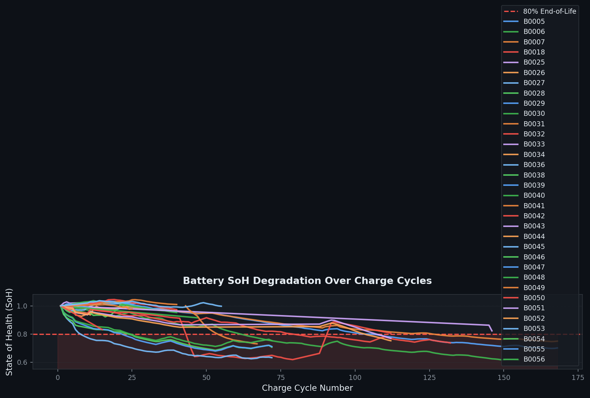

# 🔋 EV Battery State-of-Health Prediction

**An end-to-end Machine Learning project for predicting Electric Vehicle battery health using LightGBM, with an interactive Streamlit dashboard.**

<p align="center">


</p>

---

## 🚀 Project Overview

EV batteries gradually lose capacity with repeated charge-discharge cycles. Predicting their **State of Health (SoH)** helps monitor battery degradation and identify when maintenance may be required.

This project uses a **LightGBM Regressor** to predict battery SoH from:

- Average Voltage
- Operating Temperature
- Charge Cycle Count

**Model Performance**

| Metric | Result |
|---|---:|
| R² Score | 94.00% |
| RMSE | 0.0289 |
| MAE | ~0.022 |
| MAPE | ~2.4% |

## 📊 Dashboard Preview

The project includes an interactive Streamlit dashboard with two main sections.

### 1. Real-Time SoH Prediction

- Adjust voltage, temperature and cycle count.
- Generate battery health predictions.
- View SoH percentage and health status.
- Interactive gauge with an 80% threshold.

### 2. Battery Degradation Analytics

- SoH degradation across cycles.
- Battery capacity fade.
- Temperature analysis.
- Feature correlation heatmap.
- Interactive battery selection and data filtering.

---

## 🛠️ Tech Stack

| Technology | Purpose |
|---|---|
| Python | Programming |
| Pandas & NumPy | Data processing |
| Scikit-learn | Preprocessing and evaluation |
| LightGBM | SoH prediction |
| Plotly | Interactive visualizations |
| Streamlit | Dashboard development |
| Joblib | Model serialization |

---

## 📁 Project Structure

```text
EV-Battery-SoH/
│
├── train_pipeline.py
├── dashboard.py
├── generate_readme_assets.py
├── requirements.txt
│
├── data_battery_cycle/
│   └── battery_cycle_level_dataset_CLEAN_FINAL.csv
│
├── model/
│   ├── battery_model.pkl
│   ├── scaler.pkl
│   ├── feature_names.pkl
│   └── metrics.pkl
│
└── readme_assets/
    ├── plot1_soh_degradation.png
    ├── plot2_capacity_fade.png
    ├── plot3_temperature.png
    ├── plot4_actual_vs_predicted.png
    ├── plot5_feature_importance.png
    └── plot6_metrics_card.png
```

## ⚙️ Getting Started

### 1. Clone the repository

```bash
git clone <your-repository-url>
cd EV-Battery-SoH
```

### 2. Install dependencies

```bash
pip install -r requirements.txt
```

### 3. Add the dataset

Place your battery CSV file inside:

```text
data_battery_cycle/
```

Required columns:

`voltage`, `temperature`, `cycle`, `soh`

Optional columns: `battery_id`, `capacity`.

### 4. Train the model

```bash
python train_pipeline.py
```

The trained model and preprocessing artifacts will be saved in the `model/` directory.

### 5. Launch the dashboard

```bash
streamlit run dashboard.py
```

Open **http://localhost:8501** in your browser.

---

## 📈 Model Performance

### Prediction Results



### Feature Importance



### Battery Degradation



---

## 🔬 Technical Details

<details>
<summary><b>Dataset Information</b></summary>

- Source: NASA CALCE Battery Research Group
- Records: 1,415
- Battery cells: 10
- Training samples: 1,132
- Testing samples: 283
- Train-test split: 80:20

</details>

<details>
<summary><b>Model Configuration</b></summary>

| Hyperparameter | Value |
|---|---:|
| Algorithm | LightGBM Regressor |
| Estimators | 300 |
| Learning Rate | 0.05 |
| Max Depth | 6 |
| Number of Leaves | 63 |
| Subsample | 0.8 |
| Feature Sampling | 0.8 |

</details>

<details>
<summary><b>Battery Health Classification</b></summary>

| SoH | Condition |
|---|---|
| ≥ 80% | Healthy |
| 60–80% | Degraded |
| < 60% | Critical |

</details>

---

## 📚 References

- NASA CALCE Battery Research Group
- IEC 62660-1 — Lithium-ion battery performance testing
- Ke et al. (2017) — LightGBM: A Highly Efficient Gradient Boosting Decision Tree

---

<p align="center">

**Built with Python, Machine Learning and Streamlit.**

</p>
